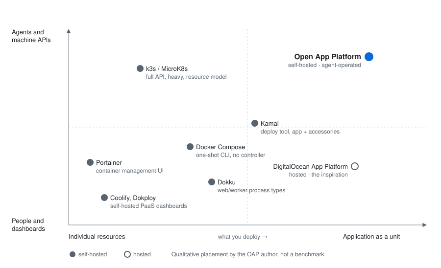
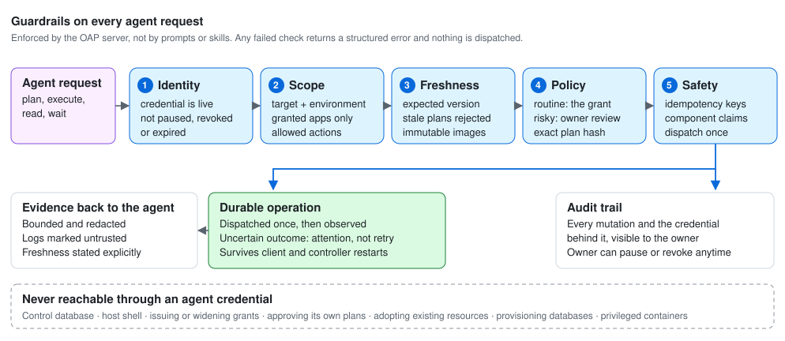
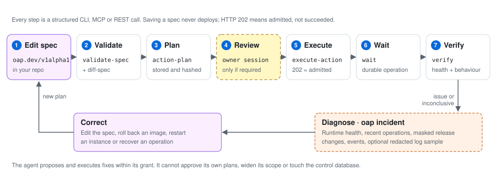
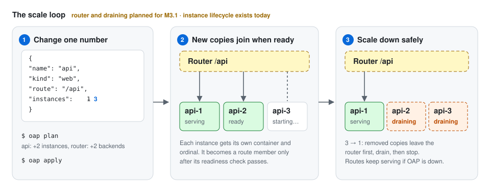
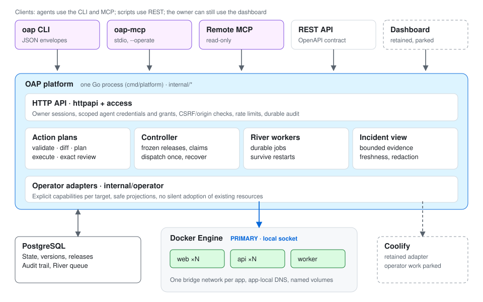

# Open App Platform

> A self-hosted application platform for one server, built for your AI agent to operate within guardrails you set.

Open App Platform (OAP) runs a whole system, such as a frontend, API, worker and
the database they use, as **one application** on a single server. You describe
it in one specification. OAP deploys, scales, rolls back and diagnoses it as a
unit, and your AI agent operates it through a JSON CLI, MCP and a REST API with
limited, audited permissions instead of a dashboard or a root shell.


> **Status:** preview. The single-server baseline is a
> [v0.1 release candidate](docs/v0.1-acceptance.md), and the agent-operated
> standalone core (M2) is in its final acceptance. It is not yet a production or
> zero-downtime guarantee. See the [roadmap](ROADMAP.md).

## Why

Self-hosting tools like Coolify, Dokploy and Portainer manage individual
resources well, but a set of services rarely behaves as one application you can
scale and roll back together, and their interfaces are built for people clicking
through a dashboard. Docker Compose is too generic and stops working once the
command exits. Kubernetes solves everything at a cost a single small server
shouldn't pay.

OAP is built on two ideas:

1. **The application is the unit.** One spec lists every component, its kind,
   instance count, connections, secret references and volumes. Releases, health
   and rollback apply to the whole application.
2. **Agents are the operator.** The spec is a file your agent edits, validates,
   diffs, plans and applies. Every change is a durable operation with structured
   evidence. The owner decides what the agent may do, and the server enforces it.



The full comparison is in [positioning](docs/positioning.md).

## Principles

- **The application is the unit.** Its components are released, scaled, rolled back and diagnosed together.
- **Agents operate; owners decide.** The agent does routine work. The owner sets authority, reviews risky changes and can stop it at any time.
- **The server enforces authority.** Permissions live in OAP, not in prompts or skills.
- **Each step means one thing.** Saving, planning, executing and verifying are separate. Saving never deploys.
- **Durable truth, honest evidence.** Operations survive disconnects and restarts. Health is `healthy`, `issue` or `inconclusive`, never guessed.
- **Small and boring.** One Go service, PostgreSQL and Docker. No embedded model. Apps keep running when OAP is down.

## Operating model

| | Owner | AI agent | OAP |
|---|---|---|---|
| **Does** | Installs OAP, issues grants, approves risky plans, pauses or revokes | Edits specs, plans, deploys, verifies, diagnoses, proposes fixes | Checks every request, runs durable operations, observes health, records audit |
| **Through** | Owner session (CLI or dashboard) | JSON CLI, MCP, REST | Docker Engine on a local socket |

**What the agent gets:** one portable spec for the whole app; validate, diff and
hashed plans; operation handles it can wait on after a disconnect; its effective
capabilities; per-instance health and logs; and a bounded incident view with
freshness stated. Every command returns structured JSON with stable error codes.

## Guardrails



Every agent request passes server-side checks before anything runs: the
credential is live, the action is inside its target, environment, apps and
allowed actions, the plan matches the current version, review policy is
satisfied (agents never approve their own plans), and retries can't run twice.
The control database, the host shell, granting authority and adopting existing
resources are never reachable with an agent credential. Logs and other
app-supplied text are marked untrusted and never treated as instructions.
Details and limits are in the [operating model](docs/operating-model.md).

## One spec for the whole application

```json
{
  "apiVersion": "oap.dev/v1alpha1",
  "kind": "Application",
  "spec": {
    "name": "shop",
    "environment": "production",
    "targetId": "docker-local",
    "components": [
      {"name": "web", "kind": "web", "image": "ghcr.io/me/web@sha256:…", "port": 3000,
       "instances": 3, "services": {"API_URL": "api"}, "dependsOn": ["api"]},
      {"name": "api", "kind": "web", "image": "ghcr.io/me/api@sha256:…", "port": 8080,
       "instances": 2, "secretRefs": {"DATABASE_URL": "shop-database-url"}},
      {"name": "worker", "kind": "worker", "image": "ghcr.io/me/api@sha256:…",
       "instances": 1, "secretRefs": {"DATABASE_URL": "shop-database-url"}}
    ]
  }
}
```

The spec lives in OAP, which keeps every version, so the application doesn't
need a repository of its own. Each service repository releases only its own
component's image ([spec ownership](docs/spec-ownership.md)). Components reach
each other by name on a private network for the app. Secrets
can be referenced by name instead of written into the spec. Images are pinned to
immutable digests, so every release is reproducible. See the
[portable lifecycle guide](docs/portable-lifecycle.md) and
[examples](examples/README.md).

## How an agent operates it



Saving a spec never deploys. Each deployment is a stored, hashed plan that runs
as a durable operation, so a disconnected agent can reconnect and check the
result. HTTP `202` means accepted, not succeeded. Verification checks runtime
health separately from the app's actual behavior. When something breaks, the
agent reads a bounded [incident view](docs/incident-diagnosis.md) and plans a
fix within its grant.

## The scale loop



Raising `instances` and applying already creates, observes and retires
individual instances. The **router** that spreads traffic across healthy copies
on one HTTPS domain, and drains copies on scale-down, is the next milestone
(M3.1). Until then, standalone Docker publishes a component through a single
fixed host port.

## What works today

| Area | Available now |
|---|---|
| Runtime | Standalone Docker over a local socket (primary); Coolify adapter retained |
| Applications | Web and worker components, multiple instances, app-local DNS, named volumes, CPU and memory limits, readiness checks |
| Releases | Frozen releases, idempotent admission, dispatch-once recovery, image rollback, scale-down with retained instances |
| Agent interface | [JSON CLI](docs/agent-cli.md), stdio MCP with optional operate tools, read-only remote MCP, OpenAPI REST, [skill](skills/open-app-platform/SKILL.md) |
| Trust | Owner account, named agents with limited grants, exact owner review for risky plans, pause and revoke, audit trail |
| Operations | Health and bounded logs, incident evidence, [headless install and rescue](docs/headless-bootstrap.md), metadata backup, [measured footprint](docs/footprint.md) |

**Next:** the router and scale loop, adding and removing components plus
pre-deploy jobs through the spec, building from source, and
[Docker Compose import](docs/compose-import.md).

## Architecture



One Go service and PostgreSQL, which holds both the state and the durable job
queue. There is no separate queue, registry, identity service or required model
runtime. Workloads keep running when OAP is down. See the
[system design](docs/architecture/system-design.md).

## Get started

**Operate with an agent:** follow the
[standalone agent runbook](docs/standalone-agent-runbook.md). It covers
installation, owner setup, granting an agent, and the full lifecycle. Build the
CLI with:

```sh
go build -o bin/oap ./cmd/oap
bin/oap help    # works offline
bin/oap schema  # complete request and response contracts
```

**Develop OAP:** requires Go 1.26, Node 22, Docker and Python 3.

```sh
cp .env.example .env.local
mkdir -p .local && cp examples/targets.json .local/targets.json
docker compose up -d --wait
npm --prefix web ci && npm --prefix web run build
make dev        # http://127.0.0.1:8787
make test-local # required pre-push gate
```

See [development, testing and deployment](docs/development.md) for details.

## Documentation

The [documentation index](docs/README.md) lists every guide. Good starting points:

- [Positioning](docs/positioning.md): the problem, the comparison and the reference application
- [Operating model](docs/operating-model.md): principles, roles, what the agent gets and guardrails
- [Roadmap](ROADMAP.md): milestones and execution order
- [Standalone agent runbook](docs/standalone-agent-runbook.md): the full headless journey
- [Feature reference](docs/feature-reference.md): detailed behavior and limits of current features

## License

Open App Platform is open source under the [MIT License](LICENSE).
Third-party notices are listed in [THIRD_PARTY_NOTICES.md](THIRD_PARTY_NOTICES.md).
