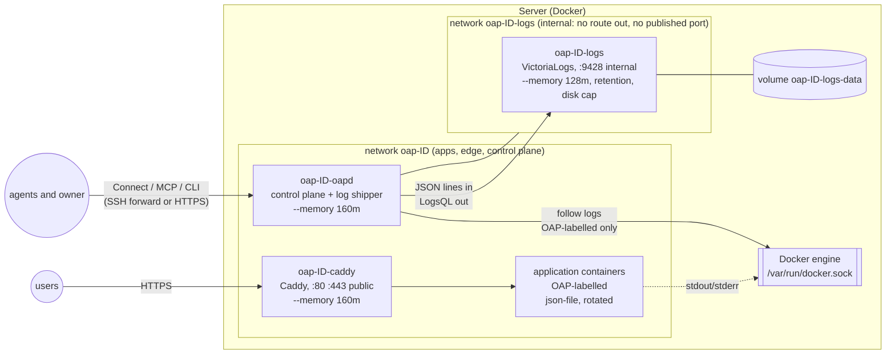
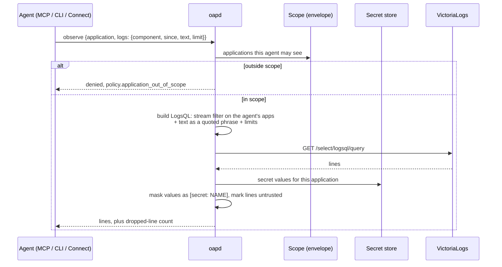

# ADR 0002: Application logs with VictoriaLogs

Status: **proposed** (2026-11-05). The owner chose the placement (part of the
OAP stack), access and release below; the design and tasks await approval. Tasks are in the
[rewrite plan](../rewrite-plan.md#proposals-awaiting-the-owner).

## Context

OAP keeps no application logs. Agents diagnose from health, events and
outcomes only, and the owner reads a container's output with `docker logs`
over SSH, which hand-off removes. Two gaps follow:

- **Diagnosis stops at "unhealthy".** `explain` can say an instance never
  became ready, not why. An agent can't read the stack trace that would let
  it fix forward on its own.
- **Logs are unbounded.** The Docker adapter sets no log options, so every
  container writes Docker's default `json-file` log without rotation. On a
  small VPS a chatty application can fill the disk, which takes down every
  application on the host and OAP with it.

## Owner decisions (2026-11-05)

| Question | Decision |
|---|---|
| Where logs are stored | **VictoriaLogs on the server, as part of the OAP stack.** `oapctl host install` installs it with oapd and Caddy, pinned by digest; upgrade and uninstall treat it the same way. It is not a separate install |
| Who reads them | **Agents, scoped to their applications, and the owner, everything** |
| Release | **v0.3** |

## Options for collecting logs

1. **oapd tails container logs through the Docker API and ships them.**
   For each OAP-labelled container, oapd follows `GET /containers/{id}/logs`
   from a saved position and sends batches to VictoriaLogs' JSON-lines
   ingestion with the OAP labels as stream fields. No extra process; the
   local `json-file` log, now rotated, is the buffer, so VictoriaLogs being
   down or restarting loses nothing that is still on disk, and never slows an
   application. `docker logs` keeps working.
2. **A Docker logging driver pointing at VictoriaLogs** (syslog or GELF).
   Nothing to tail, but with most drivers `docker logs` stops working; a
   blocking driver stalls an application when VictoriaLogs is down, and a
   non-blocking one drops lines silently; and a driver can't add OAP's
   labels as stream fields without the logging options of every container
   naming a release.
3. **A collector container** (Vector, Fluent Bit or similar) reading
   Docker's log files. Mature, but another always-on process on a 1 GB host,
   another image to pin, and broad read access to every container's logs,
   including ones OAP doesn't own.

**Proposal: option 1.** It adds no process and keeps OAP's rule that it
only touches OAP-labelled resources (the shipper never follows a container
without a complete OAP label set).

## Options for reading logs

The rewrite doc fixes seven primitives; adding an eighth is an architecture
change.

1. **Extend `observe`.** `ObserveRequest` gains an optional `logs` selector
   (component, instance or release, time range, stream, text to match, line
   limit) and `ObserveResponse` returns the lines. Logs are something an
   agent observes, so no new primitive. `explain` also attaches the last
   error lines of components it names as gaps.
2. **A new `QueryLogs` read RPC.** Clearer as an API, but an eighth
   primitive for one read path, and MCP gains a tool agents must learn
   separately.
3. **`explain` only.** The smallest change, but agents can't look at logs
   before something is already wrong, for example after a deploy that
   reports achieved but behaves badly.

**Proposal: option 1**, with `explain` attaching error lines as in option 3.

## How it works

### The stack

VictoriaLogs becomes the stack's third service. `oapctl host install`
creates it with oapd and Caddy, `install` with a newer `oapctl` upgrades it,
and uninstall removes it, its network and its volume with everything else
OAP installed.



- **oapd is the only thing that talks to VictoriaLogs.** It joins both
  networks; applications and Caddy are on `oap-ID` only, so no application
  can reach VictoriaLogs, read another application's logs or flood it
  directly. `oap-ID-logs` is created with `--internal`, and VictoriaLogs
  publishes no port.
- **Same lifecycle as Caddy.** Its image is pinned by digest in `oapctl`
  (a `VictoriaLogsImage` constant next to `CaddyImage`), recorded in
  `/var/lib/oap/images` for uninstall, labelled `io.openappplatform.role=system`
  and `component=logs`, and restarted `unless-stopped`. The install script's
  "unchanged" check covers it, so re-running install changes nothing.
- **Owner settings, not proposals.** Memory limit (128 MiB proposed),
  retention (7 days) and disk cap (the smaller of 2 GiB and 10% of the disk)
  are install settings; `oapctl host install --logs-retention 14d` and so on
  change them. The exact VictoriaLogs flags are confirmed against the pinned
  version when L2 starts.

### Collection

```mermaid
sequenceDiagram
  participant App as App container
  participant D as Docker (json-file, rotated)
  participant O as oapd shipper
  participant S as SQLite (positions)
  participant V as VictoriaLogs
  App->>D: stdout / stderr
  O->>D: list OAP-labelled containers (full label set only)
  O->>S: read position for container
  O->>D: GET /containers/ID/logs?follow&timestamps&since=position
  D-->>O: lines
  O->>V: POST /insert/jsonline (batch, stream fields)
  V-->>O: 200
  O->>S: save position
  Note over O,V: VictoriaLogs down: keep the position, retry with backoff;<br/>lines wait in the rotated json-file on disk
  Note over O: buffer full: drop oldest, count drops, show in observe
```

- **Bounded local logs, always.** Every container OAP creates, oapd, Caddy
  and VictoriaLogs included, gets `json-file` with `max-size` and `max-file`
  (for example 10 MiB × 3). The rotated file is the shipper's buffer, and on
  its own fixes the unbounded-disk gap.
- **What a line carries.** Stream fields `application`, `component`,
  `release`, `ordinal`, `instance` and `stream` (stdout or stderr), the
  message, Docker's timestamp and the container ID. Delivery is at least
  once; the container ID and timestamp tell a reader a resend.
- **Caddy's access log** can be shipped the same way as component `edge` of
  each application, so an agent can see the requests behind a failure. This
  is a follow-up, not part of L1–L6.

### Reading



- **Scoped by construction.** oapd writes the LogsQL itself from the
  structured selector, always with a stream filter on the applications in
  the agent's scope; the agent's text is a quoted phrase, never LogsQL, so it
  can't widen the filter. Only the owner API accepts raw LogsQL.
- **Bounded.** Limits on lines, bytes and time range keep a query cheap on a
  small host.
- **Untrusted and redacted.** Lines are marked as untrusted content. Values
  oapd holds in the secret store for that application come back as
  `[secret: NAME]`; the owner can read unredacted lines.
- **`explain`** attaches, for each component it names as a gap, its most
  recent stderr or error-level lines, through the same scoped and redacted
  path.
- **Policy.** Retention and limits are owner settings. Reading logs needs no
  verdict beyond scope, like `observe` today.

## Consequences

- Agents can find a cause, not just a symptom: `explain` shows the error
  lines of a failing component, and `observe` lets them check behaviour
  after a deploy.
- The stack gains a third always-on service with a fixed memory and disk
  budget. Container limits for the stack become 160 + 160 + 128 MiB. On the
  1 GB host R5.3 peaked at 452 MiB with at least 498 MiB available, so the
  margin shrinks; L6 measures it under the release journey, and the memory
  limit is an install setting if a host needs less.
- oapd gains a second network and a long-running follower per container;
  its own memory under many chatty containers is measured in L3 and L6.
- Redaction catches only values OAP knows; secrets an application derives
  or loads elsewhere can still appear. This is recorded as a known
  limitation.
- External VictoriaLogs, metrics and traces are not part of this decision.
