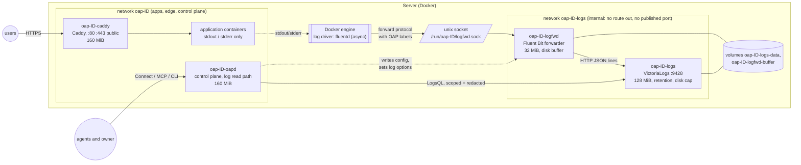
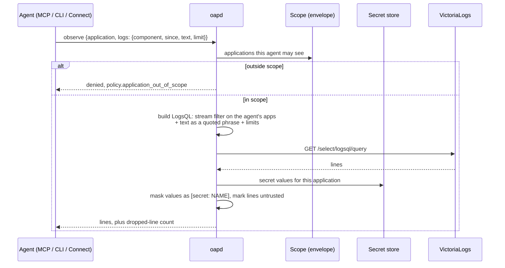

# ADR 0002: Application logs with VictoriaLogs

Status: **proposed** (2026-11-05). The owner chose the placement (part of the
OAP stack), access and release below; the design and tasks await approval. Tasks are in the
[rewrite plan](../rewrite-plan.md#proposals-awaiting-the-owner).

## Context

OAP keeps no application logs. Agents diagnose from health, events and
outcomes only, and the owner reads a container's output with `docker logs`
over SSH, which hand-off removes. Two gaps follow:

- **Diagnosis stops at "unhealthy".** `explain` can say an instance never
  became ready, not why. An agent can't read the stack trace that would let
  it fix forward on its own.
- **Logs are unbounded.** The Docker adapter sets no log options, so every
  container writes Docker's default `json-file` log without rotation. On a
  small VPS a chatty application can fill the disk, which takes down every
  application on the host and OAP with it.

## Owner decisions (2026-11-05)

| Question | Decision |
|---|---|
| Where logs are stored | **VictoriaLogs on the server, as part of the OAP stack.** `oapctl host install` installs it with oapd and Caddy, pinned by digest; upgrade and uninstall treat it the same way. It is not a separate install |
| Who reads them | **Agents, scoped to their applications, and the owner, everything** |
| Release | **v0.3** |

## Options for collecting logs

The container-native pattern is a forwarder between applications and the
store: applications write only to stdout and stderr, the runtime captures
it, and a node-level forwarder (in Kubernetes a DaemonSet running Fluent
Bit, Vector or an OpenTelemetry Collector) adds metadata, buffers and sends
to the store. Applications and the store never depend on each other. In
Docker, the forwarder can get the logs four ways:

| | How it collects | Access it needs | Fit for OAP |
|---|---|---|---|
| 1. **Docker's `fluentd` log driver → Fluent Bit** | OAP sets the driver on each container it creates; Docker pushes lines over a Unix socket with OAP's labels attached | None: no Docker socket, no host mounts. Only containers OAP configured are sent | Best |
| 2. Vector reading the Docker API | `docker_logs` source filtered by OAP labels | Docker's socket, which is root on the host and today only oapd holds | Widens trust to a third-party process |
| 3. Fluent Bit tailing host files | Reads `/var/lib/docker/containers/*` | Every container's logs on the host | Breaks "only touch OAP-labelled resources" |
| 4. oapd as the shipper | Follows each container through the Docker API | Nothing new | Puts log volume, buffering and parsing in the control plane, and couples shipping to oapd's restarts and upgrades |

**Proposal: option 1.** It is the container-native forwarder pattern
without handing the forwarder any privilege, and it keeps shipping
independent of oapd. Fluent Bit is a small C binary (a few MiB in typical
use) from the CNCF Fluentd project, which VictoriaLogs documents as a
supported sender; it buffers to disk while VictoriaLogs is down and also
accepts OpenTelemetry (OTLP) logs, which keeps OTLP-emitting applications
and later traces open without a new design. Since Docker 20.10, dual logging
keeps a local copy for `docker logs` when a remote driver is in use.

## Options for reading logs

The rewrite doc fixes seven primitives; adding an eighth is an architecture
change.

1. **Extend `observe`.** `ObserveRequest` gains an optional `logs` selector
   (component, instance or release, time range, stream, text to match, line
   limit) and `ObserveResponse` returns the lines. Logs are something an
   agent observes, so no new primitive. `explain` also attaches the last
   error lines of components it names as gaps.
2. **A new `QueryLogs` read RPC.** Clearer as an API, but an eighth
   primitive for one read path, and MCP gains a tool agents must learn
   separately.
3. **`explain` only.** The smallest change, but agents can't look at logs
   before something is already wrong, for example after a deploy that
   reports achieved but behaves badly.

**Proposal: option 1**, with `explain` attaching error lines as in option 3.

## How it works

### The stack

The stack becomes four services, installed, upgraded and removed together by
`oapctl host install` and uninstall, each pinned by digest in `oapctl` like
Caddy, labelled `io.openappplatform.role=system`, and restarted
`unless-stopped`.



- **Roles.** Docker captures output, Fluent Bit forwards it, VictoriaLogs
  stores and answers queries, and oapd configures the forwarder, sets every
  container's log options, and is the only read path. oapd no longer ships
  logs itself.
- **Isolation.** Fluent Bit and VictoriaLogs sit on `oap-ID-logs`, created
  `--internal`, which only oapd also joins. Applications and Caddy are on
  `oap-ID` only, so no application can reach the forwarder's network
  listener or the store. Docker reaches the forwarder through a Unix socket
  on the host, not a port.
- **Owner settings, not proposals.** Memory limits (128 MiB for
  VictoriaLogs, 32 MiB for Fluent Bit), retention (7 days) and the disk cap
  (the smaller of 2 GiB and 10% of the disk) are install settings, for
  example `oapctl host install --logs-retention 14d`. Exact flags are
  confirmed against the pinned versions when L2 starts.

### Collection

```mermaid
sequenceDiagram
  participant App as App container
  participant D as Docker engine
  participant F as Fluent Bit (oap-ID-logfwd)
  participant V as VictoriaLogs
  App->>D: stdout / stderr
  Note over D: dual logging: local copy kept for docker logs
  D->>F: forward protocol over the Unix socket (async),<br/>record carries the OAP labels
  F->>F: map labels to stream fields
  F->>V: POST /insert/jsonline (batched)
  Note over F,V: VictoriaLogs down: Fluent Bit buffers to its disk volume and retries
  Note over D,F: Fluent Bit down: Docker's async buffer holds lines up to its limit,<br/>then drops; the local copy still has them
```

- **Log options on every container OAP creates.** Driver `fluentd` with the
  socket address, `fluentd-async`, a bounded `fluentd-buffer-limit`, and
  `labels` naming the OAP labels so every record carries `application`,
  `component`, `release`, `ordinal` and `instance`; the record's `source`
  gives stdout or stderr. The dual-logging local copy is size-capped too. A
  container's driver is fixed at creation, so existing applications pick it
  up on their next release; the stack's own containers get it at install.
- **Never blocking an application.** Async mode means a slow or missing
  forwarder can't stall writes. The cost is loss when Fluent Bit stays down
  past Docker's buffer; Fluent Bit restarts automatically, and oapd reports
  drops it learns of (Fluent Bit's metrics and Docker's) in `observe`.
- **Only OAP's containers.** The forwarder receives only what Docker sends
  it, and Docker sends only for containers OAP created with these options.
- **Caddy's access log** can later be sent the same way as component `edge`
  of each application. A follow-up, not part of L1–L6.

### Reading



- **Scoped by construction.** oapd writes the LogsQL itself from the
  structured selector, always with a stream filter on the applications in
  the agent's scope; the agent's text is a quoted phrase, never LogsQL, so it
  can't widen the filter. Only the owner API accepts raw LogsQL.
- **Bounded.** Limits on lines, bytes and time range keep a query cheap on a
  small host.
- **Untrusted and redacted.** Lines are marked as untrusted content. Values
  oapd holds in the secret store for that application come back as
  `[secret: NAME]`; the owner can read unredacted lines.
- **`explain`** attaches, for each component it names as a gap, its most
  recent stderr or error-level lines, through the same scoped and redacted
  path.
- **Policy.** Retention and limits are owner settings. Reading logs needs no
  verdict beyond scope, like `observe` today.

## Consequences

- Agents can find a cause, not just a symptom: `explain` shows the error
  lines of a failing component, and `observe` lets them check behaviour
  after a deploy.
- The stack gains a third always-on service with a fixed memory and disk
  budget. Container limits for the stack become 160 + 160 + 128 MiB. On the
  1 GB host R5.3 peaked at 452 MiB with at least 498 MiB available, so the
  margin shrinks; L6 measures it under the release journey, and the memory
  limit is an install setting if a host needs less.
- The stack's memory limits become 160 + 160 + 128 + 32 MiB, and oapd gains
  a second network; L6 measures both under load.
- Logs can be lost if the forwarder is down for longer than Docker's async
  buffer covers; the local copy keeps them for `docker logs`, and drops are
  reported, not silent.
- Redaction catches only values OAP knows; secrets an application derives
  or loads elsewhere can still appear. This is recorded as a known
  limitation.
- External VictoriaLogs, metrics and traces are not part of this decision.
