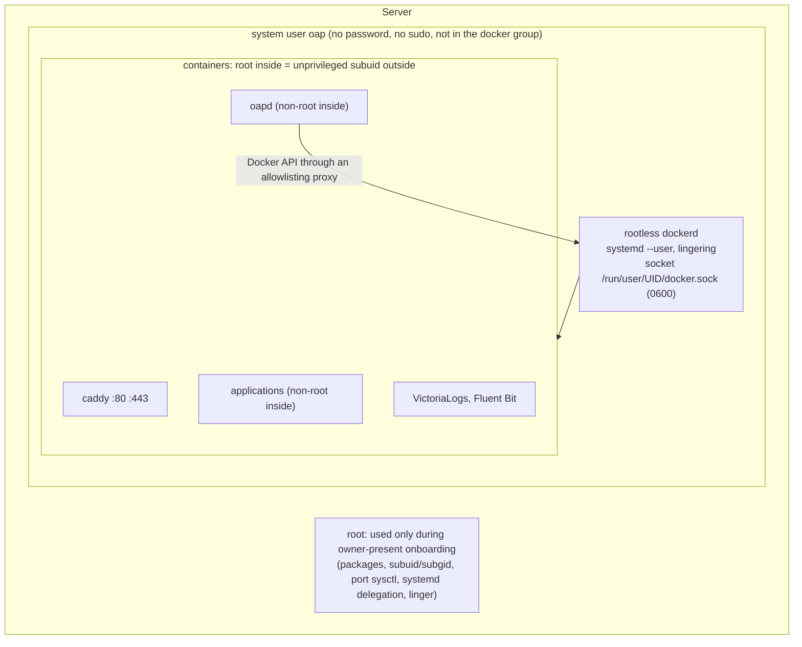
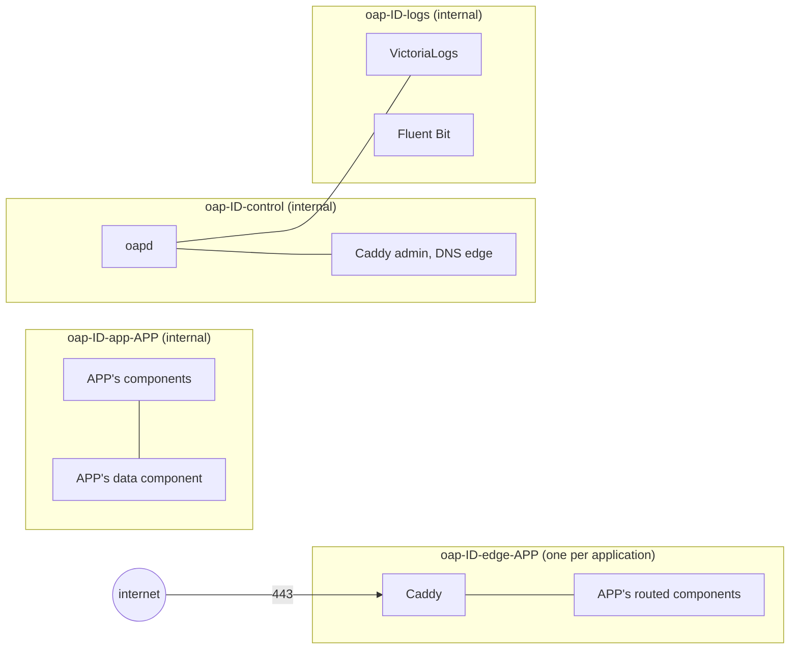

# ADR 0003: Rootless Docker, least privilege and zero trust

Status: **proposed** (2026-11-05). The owner decided the direction below;
the design and tasks await approval. Tasks are in the
[rewrite plan](../rewrite-plan.md#proposals-awaiting-the-owner).

## Context

What `main` does today:

| Part | Today |
|---|---|
| Docker | The root daemon |
| oapd | Root in its container with `/var/run/docker.sock` mounted: root on the host in effect |
| Caddy | The image's default user (root), default capabilities |
| Applications | The image's default user (often root). Only memory, CPU, mounts, ports, network and restart policy are set: no user, no dropped capabilities, no `no-new-privileges`, no read-only root, no process limit |
| `security.allow_privilege_escalation` | Accepted and validated (an exception needs a reason) but **never applied**: every container can escalate either way |
| Network | One network, `oap-ID`, for every application, Caddy and oapd. Applications can reach each other and oapd's public listener (`:8080`) and DNS responder (`:53`) |
| Secrets | Passed as environment variables, readable by anyone who can inspect the container |
| Extensions | `nobody`, except builders granted the Docker socket |

A compromised application or a bug in oapd can therefore become root on the
host, and any application can talk to any other.

## Owner decision (2026-11-05)

**Rootless, least privilege, zero trust.** Docker runs rootless as a
dedicated unprivileged user; containers run with the least privilege they
need; nothing is trusted because of where it runs on the host. Elevation
happens only when needed, never as a standing grant.

## Principles

1. **No standing root.** OAP holds no root and no sudo after onboarding.
   Steps that need root run once, during owner-present onboarding (connect,
   check, fix, install), logged; a later root-only change (a Docker engine
   upgrade, a kernel setting) is another owner-run `oapctl host fix`, never
   a sudoers entry, `NOPASSWD` rule or `docker` group membership.
2. **Default deny, explicit exceptions.** Every container starts with
   nothing: no capabilities, no privilege escalation, a read-only root, no
   network but its own. Each exception is a named spec field with a reason,
   judged `sensitive` by the envelope (the existing pattern for
   `allow_privilege_escalation`).
3. **Never by location.** Being on the server or on a Docker network grants
   nothing. APIs authenticate every call (they already do); networks carry
   only declared connections; the Docker API, even rootless, is reached only
   by oapd.
4. **Defense in depth.** Rootless bounds what host root a breakout reaches;
   in-container non-root, dropped capabilities, seccomp and read-only roots
   bound what a compromised process can do before that.

## Design

### The host

- **A dedicated user.** Onboarding creates system user `oap` (no password,
  no sudo, no `docker` group; the `docker` group is root-equivalent and is
  never used), gives it subordinate UID and GID ranges, enables systemd
  lingering so its user services run without a login, and installs Docker's
  rootless extras (`dockerd-rootless-setuptool.sh`). The rootless daemon
  runs as a `systemd --user` service of `oap`; its socket is
  `/run/user/UID/docker.sock`, mode 0600.
- **Resource limits keep working.** Memory, CPU and process limits need
  cgroup v2 with systemd delegating the `cpu`, `cpuset`, `io`, `memory` and
  `pids` controllers to user services; onboarding adds the delegation
  drop-in. This is what keeps the 1 GB budget enforceable.
- **Ports 80 and 443.** Either `net.ipv4.ip_unprivileged_port_start=80`
  (sysctl, set once at onboarding) or `cap_net_bind_service` on
  `rootlesskit`; the choice is made in H2 by test. Rootless port forwarding
  must preserve client source addresses for Caddy's logs and any future rate
  limits, so H2 picks the network and port driver (`pasta` or
  `slirp4netns`) that does, measured on the 1 GB host.
- **Host requirements.** cgroup v2 with systemd, a kernel that supports
  unprivileged overlay (5.11 or newer, else `fuse-overlayfs`), `uidmap` and
  `dbus-user-session`: in practice Ubuntu 22.04 or newer, or Debian 12 or
  newer. `oapctl host check` reports anything missing and `fix` installs it;
  a host that can't meet them is refused with the reason. **vultr_oap
  (Ubuntu 18.04, cgroup v1) must be rebuilt on a supported release.**
- **Coexistence.** A root Docker daemon already on the host is left alone
  and never used; OAP's rootless daemon has its own data directory.

### Containers

Defaults for every container OAP creates, stack and applications alike:

| Setting | Default | Exception (spec field, reason required, `sensitive`) |
|---|---|---|
| User inside the container | Non-root. An image whose default user is root runs as the spec's `user` | `security.run_as_root` |
| Capabilities | `--cap-drop ALL` | `security.capabilities: [NAME]`; never `SYS_ADMIN`, `NET_ADMIN`, `SYS_PTRACE` or `SYS_MODULE` |
| Privilege escalation | `--security-opt no-new-privileges` | `security.allow_privilege_escalation` (the existing field, now enforced) |
| Seccomp | Docker's default profile | None: `unconfined` is refused |
| Root filesystem | Read-only, a small `tmpfs` at `/tmp` | `security.writable_root` |
| Processes | `--pids-limit 256` | `resources.pids` |
| Memory | Always limited (a default when the spec sets none) | `resources.memory_mib` |
| Never allowed | `--privileged`, host network, PID or IPC namespace, devices, the Docker socket, host paths | None |

Stack services follow the same table with their exceptions fixed in
`oapctl`: Caddy gets only `NET_BIND_SERVICE` if H2 needs it, and runs as
non-root; VictoriaLogs and Fluent Bit run as non-root with read-only roots
and no capabilities; oapd runs as a non-root user with a read-only root.

### Networks

- **One internal network per application.** An application's components
  reach each other there; nothing else is on it. Applications can't reach
  each other, oapd, or the log store.
- **The edge per application.** Caddy joins each application's edge network
  holding only its routed components, so Caddy reaches exactly what it
  routes.
- **Declared connections only.** A connection to another application, if
  ever allowed, is a declared `uses` edge that oapd turns into a network
  attachment, judged by the envelope.
- **oapd's listeners leave the shared network.** The DNS responder serves
  Caddy on `oap-ID-control`; the public listener is reached through Caddy
  only; the agent socket stays a Unix socket.
- **Egress.** Unrestricted for now. An egress allowlist per application is
  a later option.

### The Docker API

Even rootless, the Docker API controls every container OAP runs. oapd
reaches it through a small proxy in the stack that allows only the
endpoints and methods oapd uses (containers, images, networks, volumes,
logs), refuses `exec`, `--privileged`, host mounts and anything the defaults
above forbid, and refuses changes to containers without OAP's labels.
Builders granted Docker access get the same proxy with a builder allowlist,
never the raw socket.

### Secrets

Secrets become files: each referenced secret is mounted read-only at
`/run/secrets/NAME` on a `tmpfs`, not passed in the environment, so
`docker inspect` and `/proc/*/environ` don't show them. A component that
can only read the environment asks for it per variable
(`secrets_as: env`, `sensitive`). Agents still see names only.

### Updates and supply chain

- Stack images stay pinned by digest; `oapctl` upgrades them.
- `oapctl host check` reports a Docker engine older than a supported minimum
  and an OS without security updates enabled; `fix` offers the remedy as an
  owner step.
- Signed releases and image signature checks remain on the v0.3 list.

## What this changes for agents and specs

- New spec fields: `user`, `security.run_as_root`, `security.capabilities`,
  `security.writable_root`, `resources.pids`, `secrets_as`. Each exception
  is `sensitive`; the skill (`author-app.md`) teaches the defaults so agents
  write specs that need none.
- Images that need root at start (some official images drop privileges in
  their entrypoint) need `run_as_root` with a reason, or a non-root image
  variant. The release journey's fixtures are updated to need no exception.

## Consequences

- A breakout from a container reaches the `oap` user's subordinate IDs, not
  root; a bug in oapd reaches the rootless daemon through the proxy's
  allowlist, not the host.
- Hosts on older releases (cgroup v1) are refused. vultr_oap needs a
  rebuild.
- Rootless networking costs some throughput; H2 measures it on the 1 GB host
  and records it.
- Some images need exceptions or replacements; each is visible in the spec
  and judged by policy.
- Existing installs move by a one-way `oapctl host migrate-rootless`, or by
  reinstalling: OAP's desired state and secrets are exported, the root
  stack removed, the rootless stack installed and applications redeployed.
