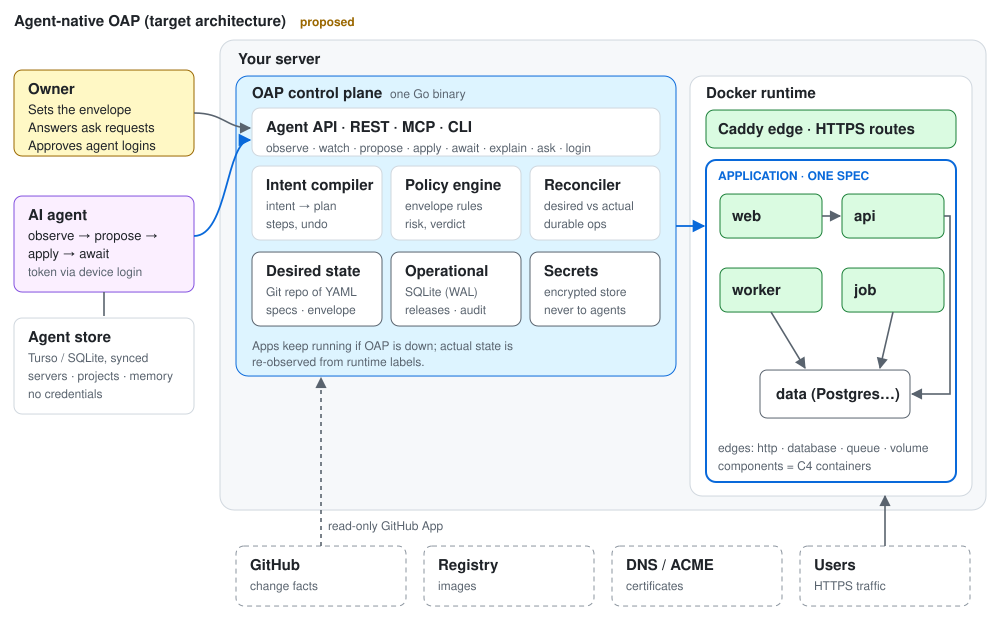

# Agent-native OAP: architecture rewrite

Status: **proposed, for owner review.** This document describes the target
architecture for rethinking OAP's interface, operating model, guardrails and
state. It does not change what is built today; the current system is described in
[system design](system-design.md). v0.1 may be delayed to adopt this direction.



## 1. Why rewrite

OAP's current surface is a human operations toolbox handed to an agent: around
twenty verbs (`validate-spec`, `action-plan`, `execute-action`, `wait`,
`rollback-plan`, `scale-down`, `remove-component`, …) plus a skill that teaches the
agent the right order. The agent is the choreographer. That works, but it scales
badly: every new capability adds verbs, sequences and failure modes the agent has
to learn.

The rewrite makes **OAP the choreographer** and gives agents a few powerful
primitives over a single model of the world. Humans stay in control, but as
policy setters and exception handlers, not as a step in the normal path.

## 2. Who it is for

**A one-person startup.** One founder, a few servers, several applications, and
AI agents doing most of the operating. Every design choice is judged by one
question: *does this take load off that person?*

Goals:

- Agents operate applications end to end (deploy, scale, diagnose, fix, roll
  back) with very little human intervention.
- The founder decides policy once and is involved only for decisions that are
  genuinely theirs: risky, irreversible or outside the agreed envelope.
- Small and boring: one binary per server, runs on a 1 GB VPS, nothing to babysit.
- Losing any single store never loses anything that cannot be rebuilt.

Non-goals: a Kubernetes API, multi-tenant fleets, an embedded model, a required
dashboard, or a general-purpose policy language.

## 3. The C4 model

| C4 level | OAP concept | Contents |
|---|---|---|
| **Context** | **Host** and actors | The server and its capacity; the owner, agents and end users; external systems (GitHub, registries, DNS and ACME, third-party APIs) |
| **Container** | **Application** and its **components** | The application is the system boundary. Components are the deployable, runnable units: `web`, `worker`, `job`, `data`, plus the shared `edge` (router) |
| **Component** | **Component interfaces** | Ports, routes, connections, volumes, checks and secret references. OAP does not model code inside a component |

C4 calls our components *containers*. The product keeps "component"; this
document notes the mapping where it matters.

Components can stand alone or be connected. Connections are **typed edges**:
`http` (a service calling another), `database`, `queue`, `volume` (shared or
owned storage) and `route` (edge to component). Edges are part of the model, not
inferred: they drive dependency order, blast radius and diagnosis.

## 4. The world model

One typed graph that every interface returns and every guardrail reasons about:

```
host
 └─ application (desired spec version, health, last change)
     ├─ component (kind, desired, actual, health, freshness)
     │   └─ instance (runtime identity, health, observed at)
     └─ edges (from, to, type)
```

Every node carries:

- **desired** and **actual** state, and whether they match;
- **health** with freshness (`observedAt`) and what evidence is missing;
- **recent changes** (the last few operations that touched it);
- **affordances**: what *this caller* may do here, as computed by the policy engine.

The graph is the agent's map and the C4 diagram at once: humans get diagrams
rendered from the same data.

## 5. Primitives

Seven primitives, identical across REST, MCP and the CLI:

| Primitive | What it does | Replaces today's |
|---|---|---|
| **observe(scope)** | Returns the world graph or a slice of it at a revision. Compact by default; drill down on request. `watch(scope, sinceRevision)` streams changes, so agents never poll | `get`, `instances`, `capabilities`, `export-spec`, `diagnostics` |
| **propose(intent)** | The agent states the outcome it wants (a spec patch, "api at 3 healthy instances", "back to release R", "remove worker"). OAP compiles it into a plan: steps, diff, blast radius, computed undo and a **policy verdict** (`allowed`, `needs-approval`, `denied`, each with reasons). Always a dry run | `validate-spec`, `diff-spec`, `action-plan`, `rollback-plan` and the action-specific verbs |
| **apply(proposal)** | Commits that exact proposal, identified by its content hash. Idempotent. Returns a durable operation | `execute-action`, `rollback`, `deploy` |
| **await(operation, until)** | Returns an **outcome**, not a status: `achieved`, `not-achieved` (with reasons and suggested next intents) or `uncertain`, plus an evidence bundle (health, declared checks, traffic, intended-vs-actual diff) | `wait`, `verify` |
| **explain(target)** | Answers "why is actual not desired?": the reconciliation gap, cause candidates, evidence and freshness | `incident` |
| **ask(request)** | The agent's structured way to involve a human: an approval, a secret, a decision or a blocker. Asynchronous, with an expiry, delivered as a notification; the answer arrives through `watch` | Ad hoc owner steps |
| **login(server)** | Device login: the agent obtains a scoped, short-lived token approved by the owner (section 8) | Hand-issued credential files |

### Response conventions

Every response is built for an agent with limited context:

- **`revision`** on every read, and `expectedRevision` on every write, so stale
  decisions are rejected.
- **`next`**: the actions this caller may take from here, already filtered by policy.
- **`why`**: stable reason codes, so agents can branch on them reliably.
- **Errors carry a remedy**: a suggested intent or the `ask` to make, never only a message.
- **Compact first**: summaries with links to detail; change feeds instead of re-reading.
- **Untrusted content is labelled**: logs, commit messages and app output are
  data, never instructions.

### Example

```yaml
# propose
intent:
  application: shop
  change: { component: api, instances: 3 }
  because: "p95 latency above target since 14:05"
source: { repo: acme/shop, commit: 9c2e1f0 }   # optional; enables change facts
```

```yaml
# response (abridged)
proposal: prop_7Hq2…            # content hash; apply this exact proposal
verdict: allowed                # policy engine decision
risk: routine                   # computed by OAP, never declared by the agent
steps: [start api-2, start api-3, wait ready, add to route /api]
blastRadius: { components: [api], downtime: none-expected }
undo: { change: { component: api, instances: 1 } }
next: [apply]
```

## 6. Operating model

```
observe → propose → policy ─ allowed ──────────→ apply → await → (explain → propose …)
                          ├─ needs-approval → ask → owner answers → apply
                          └─ denied → reasons + remedy
```

- **Agents** run the loop end to end.
- **OAP** compiles intents, enforces policy, executes durable operations, keeps
  actual state converging on desired state, and reports the gap honestly.
- **The owner** sets the autonomy envelope once, answers `ask` requests, and reads
  a periodic digest of what agents did and why.

Reconciliation is **on demand** at first: OAP converges when a proposal is
applied or an operation is recovered. A continuously running loop that changes
things on its own is a later, explicit option.

## 7. Guardrails: the autonomy envelope

Today's guardrails mostly control which verbs a credential can call. The rewrite
judges **the proposed change** against an owner-written envelope, stored as
versioned YAML next to the applications.

```yaml
# policy/envelope.yaml (sketch)
agents:
  claude-laptop:
    scope: { applications: [shop], components: [web, api, worker] }   # not data
    may: [deploy, scale, rollback, restart, configure]
invariants:
  - "shop.web.healthy >= 1"
  - "no change to a component with a volume without a fresh snapshot"
  - "releases per application per hour <= 3"
  - "stay within host and app quotas"
risk:
  sensitive: [domains, routes, secret-bindings, quota-changes, pruning]
  irreversible: [volume-deletion, destructive-migration]   # always ask
change-facts:                       # from GitHub, see below
  migrations-changed: sensitive
  ci-not-green: deny
  lockfile-changed: sensitive
  docs-only: routine
breakers:
  failed-applies-per-hour: 3        # then pause the agent and notify
```

The policy engine evaluates every proposal deterministically:

1. **Scope** by C4 level: which applications, components and edges an agent may touch.
2. **Invariants** the system must keep true after the change.
3. **Risk tier computed from the diff and blast radius**: routine changes run;
   sensitive ones become `ask`; prohibited ones are denied with reasons.
4. **Reversibility**: every applied proposal has a computed undo. Anything
   irreversible always requires the owner.
5. **Evidence gates**: promotion requires recorded checks (M3.3a).
6. **Change facts from code hosting** (below).
7. **Circuit breakers, rate limits and a kill switch** (pause and revoke).

Existing protections remain: secrets never reach agents, untrusted content is
labelled, two-phase host trust, isolated builds.

Because policy is data, agents can ask "what may I do here?" up front (the `next`
affordances in `observe`), and the same rules are testable in the QA track (Q1).

### Change facts from GitHub

Some guardrails need to understand the change, not just the deploy. A proposal
names its source (commit or pull request). Through a **read-only GitHub App**
connected once by the owner, OAP fetches facts: files changed, whether migrations
or dependency lockfiles changed, CI status, review state and commit signature.
The envelope maps those facts to risk. Every image records the commit that built
it, so a release's evidence includes commit, pull request and CI result.

## 8. Identity and access

**Credentials never leave the server.**

1. **The owner logs in once to the OAP instance on the server.** Third-party
   connections (GitHub App, registries, DNS, notification channels) are made
   there, once, and stored in the server's encrypted store.
2. **Agents use those connections only through OAP capabilities** ("build this
   commit", "pull this image"). Where a workload needs a third-party credential,
   OAP injects it at the network edge so neither the workload nor its agent can
   read it (the exe.dev integration pattern).
3. **Agents sign in with a device login**, never a copied token:

   ```
   agent (any machine):  oap login https://oap.example.com
                          → "Approve agent 'claude-laptop' with code K7P-4QD"
   owner (phone/laptop):  approves, choosing scope and envelope
   agent:                 receives a short-lived, scoped, refreshable token
                          stored on that machine only, never synced
   ```

4. **Session approval policy**, owner-chosen per agent:

   | Mode | Friction | Risk |
   |---|---|---|
   | Approve every new session (default) | Highest | Lowest |
   | **Trusted agent identity**: approve an identity once, bound to a key its platform holds; new sessions sign in automatically and the owner is notified | Low | Depends on key custody |
   | Auto-approve within scope: narrow, short-lived tokens for routine work only | Lowest | Bounded by the envelope |

5. **Pause and revoke** remain instant in every mode.

Host access (SSH, root) exists only during an owner-present bootstrap and is
handed back at the end of installation ([zero to live](../zero-to-live.md)).

## 9. State and storage

Four kinds of state on each server, plus the agent's own store:

| State | Contents | Written by | Home | If lost |
|---|---|---|---|---|
| **Desired** | Application specs, the envelope, host settings | Agents (via proposals), owner | **Git repo of YAML** on the host | Restore from the mirror or the agent's copy |
| **Operational** | Releases, operations, dispatch journal, claims, grants, audit index | OAP | **SQLite** on the host, continuously backed up | Restore from backup; rebuild bindings from runtime labels |
| **Actual** | Containers, volumes, routes | Docker, Caddy | **The runtime**, with OAP labels on every resource | Never stored as truth; always re-observed |
| **Secrets** | App secrets, third-party connections | OAP, owner | **Encrypted file store**, key held separately | Restore store and key from the owner's backup; never sent to agents |
| **Agent store** | Servers, projects, repo ↔ app links, memory | The agent | **Turso / SQLite**, synced | Rebuild from `observe`; no credentials to lose |

**Rule: no single store is the only copy of anything that cannot be re-observed.**

### Desired state as a Git repo of YAML

```
/var/lib/oap/desired/          # an embedded Git repository
  host.yaml
  policy/envelope.yaml
  apps/shop/app.yaml
  apps/blog/app.yaml
```

- Each saved version is a commit with author (owner or named agent) and message.
  History, diff and revert (M3.2d) come with it; export is a one-way push to a mirror.
- **Discipline:** JSON Schema validation, a canonical stored form with a content
  hash, and a strict YAML subset (no implicit booleans or floats). JSON is
  accepted wherever YAML is.
- This refines [spec ownership](../spec-ownership.md): OAP still owns the spec and
  remains the single writer; the repo is OAP's storage format, not a second
  writable source.

### Decision: replace OAP's PostgreSQL and River with SQLite

This concerns **OAP's own control-plane database only**. Users' applications can
still use PostgreSQL, Redis or anything else, and Z3 runs them as owned data
services.

- **Context:** OAP stores its metadata in a dedicated PostgreSQL and runs durable
  jobs on River, which requires PostgreSQL. On the 1 GB VPS run, OAP's PostgreSQL
  peaked at **70.7 MiB** of an OAP stack peak of about 123 MiB (with Caddy); it
  is also one more service to run, upgrade, tune and back up.
- **Decision:** one SQLite database in WAL mode inside the OAP binary, and a small
  SQLite-backed job table providing the same guarantees River gives today:
  durable enqueue, single dispatch, recorded intent before side effects, and
  recovery after a crash.
- **Backups:** continuous replication of SQLite changes (Litestream or similar)
  to object storage or another machine, plus periodic snapshots.
- **Consequences:** a smaller footprint and simpler operations; a real migration
  (schema, queue semantics, tests) with tooling to move an existing install; SQLite
  limits OAP to one writer process per server, which matches the one-binary design.

### Runtime labels

Every container, volume and route OAP creates carries labels naming the
application, component, release and ordinal. If operational state is lost, OAP can
rebuild its bindings by observing the runtime, and refuses to adopt anything
without its labels.

### Recovery matrix

| Lost | Impact | Recovery |
|---|---|---|
| Operational database | History and in-flight operations forgotten; apps keep running | Restore from replica; rebuild bindings from labels; reload desired state; owner re-issues grants |
| Desired-state repo | Cannot plan changes | Restore from mirror or agent copy; worst case export from what is running |
| Secret store or its key | New deploys cannot inject secrets; running apps continue | Restore store and key from the owner's backup; without the key, secrets are unrecoverable by design |
| Whole host | Everything on it | Desired state + operational backup + secret store + data backups on a new server |

## 10. The agent store

The agent operates several servers and projects, often from temporary machines or
cloud sessions, so it needs memory that is not tied to any server:

- **Contents:** servers (URL, host fingerprint), projects and repo ↔ application
  links, build settings, preferences, and memory of past incidents and fixes.
- **No credentials.** Tokens come from device login and stay on the machine that
  obtained them.
- **Turso / libSQL with embedded replicas:** local reads and writes, offline
  operation, sync when connected. Sync to Turso Cloud, or to a self-hosted libSQL
  server that OAP can run on the owner's own server so nothing leaves their
  infrastructure.
- **Conflicts:** records are small and mostly append-only; live truth always comes
  from `observe` on the server, never from the agent store.

On a new machine the agent syncs its store, sees which servers and projects it
manages, runs `oap login`, and continues.

## 11. Interfaces

- **One semantic API** (the world model and seven primitives), versioned and
  described by a single schema.
- **REST** is the reference transport. **MCP** exposes the same primitives as a
  handful of tools, locally (stdio) and remotely (HTTPS with device login).
  **The CLI** is a thin client that also owns the agent store and device login.
- **Events:** `watch` streams revisioned changes, including `ask` answers and
  operation outcomes.
- **Idempotency** comes from proposal content hashes and operation IDs, not
  client-chosen keys.
- **Compatibility:** today's API stays available during migration; new features
  land only on the new surface.

## 12. From today to the rewrite

Much of the machinery exists and is reused:

| Today | Becomes |
|---|---|
| Action plans (stored, hashed, reviewable) | `propose` |
| Durable operations, replay, dispatch-once recovery | `apply` and `await` |
| Incident view | `explain` |
| Grants, owner review, pause and revoke | Enforcement core of the envelope |
| Portable spec | Desired-state half of the world model |
| Runtime labels, observation recovery | Rebuild-from-runtime |
| Encrypted secret store | Secrets store and edge injection |

New: the world graph and `watch`, one intent compiler, the policy engine and
envelope, outcome-based `await`, `ask`, `login`, computed undo, GitHub change
facts, the YAML desired-state repo, SQLite operational state and the agent store.

## 13. Migration plan

Each phase ships usable value and keeps existing installs working:

1. **Model and storage foundation:** world graph read model and `observe`/`watch`;
   desired-state Git repo with history; runtime-label rebuild.
2. **Intent and policy:** intent compiler behind `propose`; envelope YAML and
   policy engine; computed undo; outcome-based `await`; `explain` from the
   incident view.
3. **People and identity:** `ask` with notifications; device `login`; owner
   one-time connections; GitHub change facts.
4. **Storage switch:** SQLite operational store and job table; migration tool from
   PostgreSQL; continuous backup.
5. **Agent client:** new CLI and MCP over the primitives; Turso agent store;
   compatibility layer for the old API, then its deprecation.

## 14. Lessons from the v0.1 VPS run

The 15 October run ([evidence](../evidence/release-journey/2026-10-15-11d5b85/README.md))
passed everything up to scale-down on a 1 GB host, but **2 of 277 requests failed
while scaling 3 → 1**, near a Caddy configuration reload. Root cause is not yet
established. For the rewrite this means:

- The reconciler, not the agent, owns traffic safety during topology changes:
  membership removal, drain, reload behavior and stop order are one tested unit.
- `await` evidence must include per-request traffic data (timestamps and error
  reasons), so outcomes like this are diagnosable from the evidence bundle alone.
- Footprint data from the same run (OAP 24.8, PostgreSQL 70.7, Caddy 27.0 MiB
  peaks) is the baseline for the SQLite decision.

## 15. Risks

- **Hiding mechanics:** if OAP only says "done", agents cannot learn or diagnose.
  Proposals always list their steps; outcomes always carry evidence.
- **Policy creep:** keep the envelope a small, data-driven set of scopes,
  invariants and risk mappings, not a general language.
- **Reconciliation complexity:** start on demand; continuous convergence only by
  explicit opt-in.
- **Storage migration:** SQLite queue semantics must match today's durability
  guarantees before any install is moved; keep PostgreSQL support until migration
  tooling is proven.
- **Device login friction** for short-lived agent sessions: mitigated by trusted
  agent identities, at the cost of key custody.

## 16. Decisions needed

1. Default session approval mode (section 8): every session, or trusted identity
   offered at first login?
2. Default autonomy for a fresh install: routine changes allowed without the
   owner, or everything gated until the owner relaxes the envelope?
3. Agent store sync default: Turso Cloud, or self-hosted libSQL on the owner's server?
4. Whether to fix the scale-down loss on the current code first, or only within
   the rewrite's reconciler.
