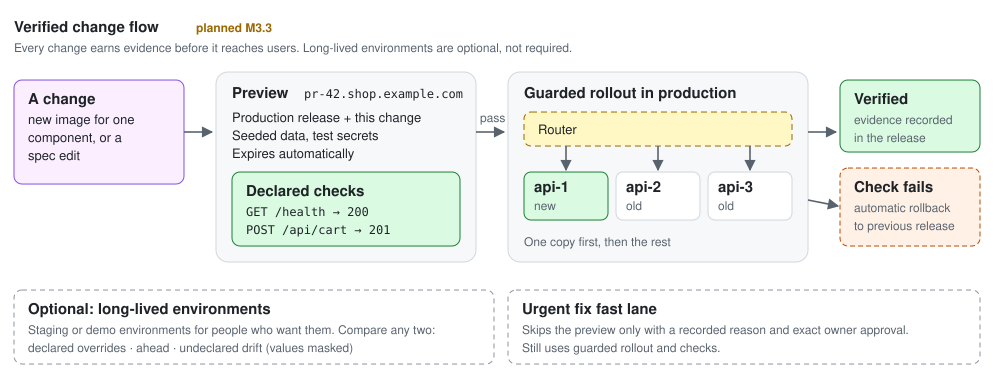

# Environments and verified change

Status: **planned.** Roadmap slices M3.3a (declared checks and guarded rollout,
v0.2), M3.3b (previews and promotion, v0.4) and M3.3c (environment comparison,
v0.4). Builds on the M3.1 router and M3.2
specification-driven topology. Today OAP supports separate environment records
grouped under one logical application ([application environments](application-environments.md))
and comparison of two releases within one environment ([release comparison](release-comparison.md)).



## The idea

A traditional `dev → staging → production` chain exists because building an
environment was expensive and testing was slow and manual, so changes queued in
a shared staging copy until someone checked them. With agents and a declarative
spec, an environment is cheap to create and testing happens on every change.

The underlying need does not go away: **evidence that a change works before
users depend on it.** OAP keeps that need and drops the required shape. The
default flow is preview → checks → guarded rollout. Long-lived environments and
comparing them stay available for people who want them; nothing enforces them.

## Default flow

### Preview environments

- Built from **production's current release plus one change**: a new image for a
  component, a spec edit, or both.
- Served on its own route, for example `pr-42.shop.example.com`.
- Uses non-production secret bindings and seeded or empty data. A live production
  database is never attached. A scrubbed data snapshot is a separate, explicit
  owner action.
- Limited in number at any one time and removed automatically when it expires,
  because previews share the server's CPU and memory.

### Declared checks

The spec declares deterministic checks that OAP runs and records as evidence:

```jsonc
"checks": [
  {"component": "api", "request": "GET /health", "expectStatus": 200},
  {"component": "api", "request": "POST /api/cart", "body": "fixtures/cart.json", "expectStatus": 201},
  {"component": "worker", "probe": "job", "expect": "processed"}
]
```

An agent saying it tested something is not evidence. A recorded check result
against an exact release is.

### Guarded rollout

Using the M3.1 router, a release updates **one instance first**, runs the checks
against it, then updates the rest. A failed check rolls back automatically to the
previous release. Because old and new instances overlap, schema changes must be
backward compatible (add first, remove in a later release).

### Promotion of verified releases

Production can require, by owner policy (off by default), that the **exact image
digests** passed checks in a preview. The same artifact is promoted, never
rebuilt.

**Urgent fixes** use a fast lane: the preview may be skipped only with a recorded
reason and exact owner approval. Guarded rollout and checks still apply. Because
there is no long-lived staging drifting ahead of production, a fix needs no
back-port tracking between environments.

**Unreleased features** are held behind feature flags in the deployed code rather
than in a divergent environment, so the difference is visible in configuration.

## Optional long-lived environments

Named environments such as `staging` or a client demo remain supported. They use
one base spec with small per-environment overrides:

```jsonc
"environments": {
  "staging":    {"domain": "staging.shop.example.com", "instances": {"api": 1}},
  "production": {"domain": "shop.example.com",         "instances": {"api": 3}}
}
```

A read-only **comparison** of any two environments' current releases sorts every
difference into one of three groups, with secret values masked:

| Group | Meaning | Example |
|---|---|---|
| Declared | Intended per-environment overrides | Domain, instance counts, secret bindings, limits |
| Ahead | Changes one side has that the other lacks | Newer `api` image, new component, new config key |
| Drift | Undeclared differences | A manual change in one environment |

The comparison covers specs, images, configuration keys and current health. It
does not compare data, schema state or external services, so "similar" means
similar configuration, not proof of identical behavior.

## Guardrails

- Grants are per environment. An agent can have broad access to previews while
  production requires exact owner review.
- Previews never receive production secrets or production data.
- The fast lane always needs a reason and owner approval, and is marked in the
  audit trail and release history.
- Automatic rollback restores images, not data.

## Agent journey

1. Build an image or edit the spec for the change.
2. Open a preview; OAP runs the declared checks and returns evidence.
3. Plan a production release of the verified digests; the owner approves if
   policy requires it.
4. Guarded rollout runs; `wait` and `verify`; a failed check rolls back on its own.
5. The preview expires and is cleaned up.

## Acceptance (M3.3a–c)

- An agent opens a preview for an API change; declared checks pass and are
  recorded against the exact release.
- The production release rolls out one instance first and completes.
- An injected failing check rolls back automatically to the previous release.
- The preview expires and its containers are removed.
- Comparing two named environments reports declared, ahead and drift entries
  without secret values.

## Non-goals

No required environment chain, no copying of production data by default, no
weighted or blue-green traffic policies in this slice, and no claim that a
passing preview proves behavior under real production traffic.
