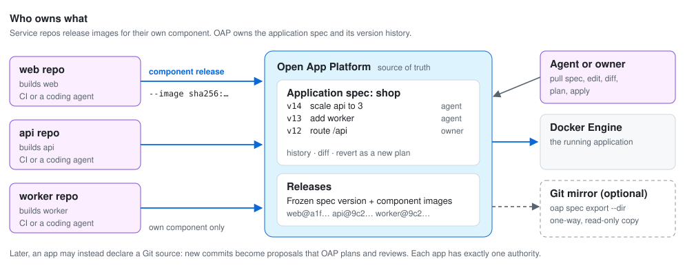

# Where the application spec lives

Status: **design decision with planned work.** The model below matches what
exists today (versioned definitions stored in OAP, `export-spec`, per-component
image overrides on deploy, and the GitHub release hook that maps one repository
and branch to selected components). The gaps are scheduled in the
[roadmap](../ROADMAP.md) under M3.2d (v0.2), Z2 (v0.3, on-server builds with component-scoped release
grants) and the deferred table. Agents, not Git webhooks, are the default release
trigger; see [zero to live](zero-to-live.md).



## The problem

An application is usually spread across several repositories: a frontend in one,
an API in another, a worker somewhere else. No single repository is the natural
home for the definition of the whole application, yet something has to hold it
and something has to trigger releases.

## Decision: split topology from image versions

| | Application spec | Component image version |
|---|---|---|
| Describes | Components, kinds, instance counts, routes, connections, secret references, volumes | Which build of a component runs |
| Changes | Rarely: add a worker, scale, add a route | On every merge to a service repository |
| Owned by | **OAP**, versioned with history | **Each service repository**, through CI or a coding agent |
| Changed with | pull → edit → diff → plan → apply | a component release with an immutable image |

1. **OAP is the source of truth for the application spec.** Every saved change
   creates a new definition version. No repository holds the whole application.
2. **Service repositories release only their own component.** A repository's CI
   or agent builds an image and asks OAP to release that component with the
   image digest. It never edits the spec.
3. **A release freezes both:** the spec version and the image of every component.
   Rollback and comparison work on releases.

## Why OAP owns it, not a Git host

- **One place for authority.** If merging to a "manifest repository" could change
  production, Git write access would become deploy authority and bypass grants,
  owner review and audit. With OAP as the owner, every change passes the same
  server-side [guardrails](operating-model.md#guardrails).
- **One writer.** Two writable sources (Git and OAP) drift. Most GitOps pain is
  keeping them in sync.
- **State lives together.** Secret bindings, version checks, stale-plan
  rejection and frozen releases all reference OAP's stored versions.
- **No required dependency.** Topology changes need no Git host, credentials or
  webhooks, and work offline on one server.
- **Agents don't need Git for this.** Pulling, editing, diffing, planning and
  applying a spec is as natural for an agent as opening a pull request, with
  stronger guarantees.

## Keeping what Git does well

| Git habit | OAP equivalent |
|---|---|
| `git log` | `oap spec history`: every version with author (owner or named agent), time and message |
| `git diff` | `oap spec diff v12 v13`, with secret values masked |
| `git revert` | `oap spec revert v12`: creates a new version through a plan, never rewrites history |
| Pull request approval | Owner approval of the exact plan hash |
| A copy in a repo | `oap spec export --dir ./oap`: a one-way, read-only mirror for backup, reading and search |

Spec history is part of OAP's metadata, so it is covered by the existing
metadata backup and recovery procedure.

## Workflows

**Release from a service repository.** An agent working in the `api` repository
changes code, runs tests, builds and pushes an image, then releases it:

```sh
# release.json: expectedVersion, components ["api"], and the api image override
bin/oap --app "$APP_ID" --file release.json --key api-release-42 deploy
bin/oap --operation "$OPERATION_ID" --timeout 5m wait
bin/oap --app "$APP_ID" verify
```

This works today with an app credential; see the [agent CLI](agent-cli.md).

CI can do the same, or use the existing [GitHub release hook](github-releases.md),
which maps a repository and branch to the app's selected components. A
**component-scoped release grant** limits that credential to its own component.

**Change the application.** An agent asked to "add a worker and scale the API to
three" works on the spec, not on any service repository:

1. Export the current spec (`export-spec` today; literal values are omitted and
   must be refilled before saving).
2. Edit it, then `validate-spec` and `diff-spec` against the current version.
3. Create a `configure` action plan; the owner approves it if policy requires.
4. Execute the plan, which saves a new version.

The [portable lifecycle guide](portable-lifecycle.md) has the exact commands.

Saving the spec does not deploy. A deploy plan follows, as for any change.

## Later: Git-sourced apps

An app may declare a Git source instead (repository and path). New commits on
that path become **proposals**: OAP validates them, builds a plan, applies the
owner's review policy and only then saves a new version. While an app is
Git-sourced, its spec is read-only inside OAP. Each app has exactly one
authority; OAP never accepts writes from both. This mode is deferred until the
OAP-owned model is proven.

## Planned work

| Item | Roadmap |
|---|---|
| Spec history, version diff and revert as a plan | M3.2d |
| Change metadata on each version: author, time, message | M3.2d |
| `oap spec export --dir` one-way mirror | M3.2d |
| Component-scoped release grants | Z2 |
| Git-sourced apps | Deferred |

## Non-goals

No bidirectional Git sync, no automatic adoption of a repository's Compose or
manifest files, and no Git host as a required dependency.
