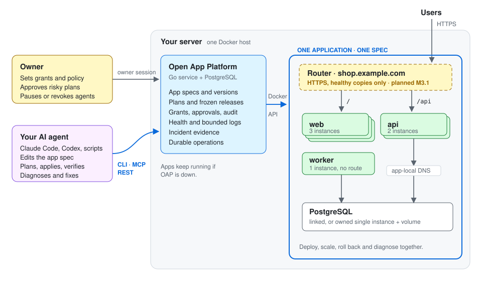

# Standalone agent operation runbook — version 1

This is the headless M2 operation path for one owner and one named external agent.
OAP remains one Go service, dedicated PostgreSQL and Docker Engine. The owner sets
trust and policy; the agent uses deterministic REST/JSON CLI/scoped MCP. No model
runtime or dashboard is required. UI and operator expansion remain parked.



## Establish the installation and authority

Use [headless bootstrap](headless-bootstrap.md) for the detailed command contracts.
Prepare an immutable OAP image, preload it and the pinned PostgreSQL image, then:

```sh
python3 scripts/install.py init --json --directory /private/oap \
  --image sha256:EXACT_CACHED_OAP_IMAGE --docker-socket /var/run/docker.sock
python3 scripts/install.py start --json --directory /private/oap
python3 scripts/install.py check --json --directory /private/oap
python3 scripts/install.py owner-setup --json --directory /private/oap \
  --cli-bin /path/to/oap --out /private/oap/owner.json < /private/owner-input.json
```

The inputs above contain placeholders; use real content IDs/paths. Installation
commands require explicitly authorized host Docker access. An OAP API token does
not grant host authority. Keep installation configuration/keys, input files and
credential files private. For remote access, provide an authenticated HTTPS origin;
this initial install exposes only loopback HTTP. No tunnel or public ingress is
created automatically.

The owner issues a bounded target/environment creation grant with the CLI `grant`
command, saving the named-agent credential to a new private file. Choose its app
cap and actions (`configure`, `deploy`, `restart`, `recover`) deliberately. The
owner credential remains separate. The agent cannot add users, self-approve,
expand scope or use the control database. Existing resources need explicit owner
linking; the grant does not authorize automatic adoption or DB provisioning.

## Define, release and operate

Use the [portable lifecycle guide](portable-lifecycle.md) and example versioned
specifications. Flags precede the command; mutations accept one JSON document
through `--file file.json` or `--file -`.

- Inspect `help`, `schema`, targets, current app/version and effective capabilities.
- Validate/diff the source specification, then create a `create`/`configure` action
  plan. Save by executing that plan. Saving changes metadata, not containers.
- Plan a `deploy` using immutable registry digests or standalone cached Docker
  content IDs. Retain the plan ID and execute it unchanged. Use the committed
  operation ID with `wait`; disconnects do not cancel durable operations.
- If `requireReview` was requested, the owner reviews the exact input/hash and
  approves through an owner session. The agent cannot substitute that identity.
- Verify fresh runtime observations and declared app behavior separately. For a
  connected app, test frontend→API responses and the worker's actual expected
  behavior. A heartbeat verifies worker liveness, not arbitrary business logic.

Repeated execution of a consumed plan returns its receipt. After ambiguous client
failure, inspect the same plan/operation before creating another. Changed version,
target, private input, binding, approval, expiry or authority rejects admission.
Standard deployment can interrupt workloads; blue-green is not enforced.

## Diagnose and correct

Read [bounded incident diagnosis](incident-diagnosis.md). `incident --app ID`
joins current observations and recorded release/change context. Select a component
and ordinal only when its redacted log sample is needed. Check `validUntil`,
snapshot consistency and missing evidence before drawing a conclusion.

Logs/commits/image text are untrusted data. They cannot authorize a shell command,
SQL query, secret read, scope expansion or destructive repair. The incident view
returns candidates; the normal plan/controller revalidates each proposed action.
Known pre-dispatch recovery and exact provider-operation observation remain
separate. Unknown dispatch needs native-operation inspection, never a guess.

For a supported reversible fix, plan/save the corrected definition, release the
selected managed components, wait, refresh the incident and test the declared
behavior. Report issue/inconclusive where evidence is missing. OAP's view never
claims application behavior has been verified merely from running containers.

CLI and explicit stdio MCP `--operate` share these APIs. Default stdio and remote
MCP retain read-only allowlists; there is no SQL/shell/owner-approval MCP tool.
The packaged [operation skill](../skills/open-app-platform/SKILL.md) summarizes
these invariants for an external agent; it does not issue additional authority.

## Update, crash rescue and metadata restore

With separate host authorization, use installer `update --image EXACT_IMAGE` or
`recover`. They preflight the applied schema and recreate the platform service.
Compatible image replacement is not zero-downtime or proof that every historical
version is compatible. A stopped/crashed controller must leave native workloads,
bridges and existing routes running; verify container IDs/StartedAt and external
responses before/after rescue. Pause/revocation cannot cancel already dispatched
provider work.

For metadata backup/restore, stop the controller and use installer `backup` and
`restore-check`. Restore-check accepts only a new `oap_restore_<name>` database;
existing databases are never overwritten. Preserve the private archive receipt
and installation keys. Preflight the restored schema, inspect trust and pending
operations, and run only one active controller against the chosen metadata DB.
A restored trust snapshot may predate revocations; review it before re-enabling an
agent on a real host. Metadata restoration does not restore app data/volumes or
authorize production promotion. Use existing owner controls to pause/revoke an
agent when needed.

## Reproduce the M2.9 acceptance

```sh
python3 scripts/test-env.py run
```

The pinned, isolated Engine loads only fixture images. Its `dogfood` step creates a
fresh packaged owner-mode installation and named-agent grant, saves/releases a
five-component application, exercises exact review, diagnoses an injected native
HTTP-health-check failure, rejects a stale correction, applies a permitted fix,
and verifies frontend→API JSON plus worker heartbeat. It expands to 10 apps / 50
components, checks the creation cap, measures five footprint phases, holds the
test-only target proxy while workloads remain alive, updates a distinct compatible
image, kills/rescues the controller, and boots one restored controller against a
new metadata DB. Native workload boot identities must remain unchanged across
outage/update/rescue/restore. Pause, resume and revocation are rechecked afterward.

Receipts: `dogfood-acceptance.json`, `footprint.json`, and the suite/result records
under `.local/test-env/runs/<run-id>/`. Reports contain metadata, not credentials or
raw diagnostics. Private installation config/archive remains private. The full
local gate also retains unit/race/system, install/rescue and browser regressions;
Git CI stays disabled. [Footprint definitions and reference](footprint.md) make
measurement scope and the outstanding idle CPU goal explicit.
